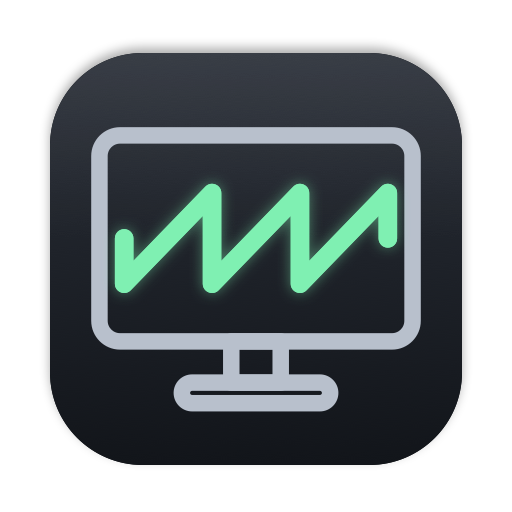

<p align="center"></p>

# LoudStation

**No sound from your monitor speakers on an Apple Silicon Mac?** If speakers or headphones plugged into an external display (USB-C, DisplayPort, HDMI or a dock) go silent after you plug in or wake the Mac, and Spotify, YouTube or Netflix freeze or won't play, LoudStation spots it from the menu bar and fixes it without you unplugging anything.

> Apple Silicon only (M1, M2, M3, M4 and later); runs on macOS 13 and later, in 37 languages. Tested so far only on macOS 27 (Golden Gate) on an M1 Max with three Dell displays. Reports from other setups are very welcome.

## The symptoms

You use speakers or headphones plugged into a display. After connecting the displays, waking the Mac or docking:

- Music apps or a browser show "playing" but make no sound, or pause themselves.
- Videos freeze, refuse to start or stutter, in any app.
- The display still appears in Sound settings and the volume slider moves, but nothing plays.
- Switching the output to the Mac's own speakers works instantly.
- It lasts until you replug the display or restart. Restarting `coreaudiod` does not help.

It happens most with several displays connected at once, for example a lid-closed MacBook on a dock driving a multi-monitor desk.

To check whether this is your problem, run `loudstation`. "No Sound" next to a display means its audio is stuck.

## What is actually wrong

On Apple Silicon each external display is driven by a DCP (display coprocessor), which also carries that display's audio. The logs suggest that when several displays come up at the same moment, their audio link setup, which is tied to HDCP negotiation, collides. The kernel logs `AppleDCPDPTXAudioLinkDelegate::handleStartLink Failed to get workloop` or `HDCP Startup Failed`, yet the link is reported as started. The audio engine's clock then never runs. `coreaudiod` waits 10 seconds for it and gives up "after 0 frames", and every app playing to that output stalls. Video players wait on the audio clock, so video stalls too.

The full investigation, with log evidence, is in [`docs/`](docs/README.md).

## What LoudStation does about it

It checks whether a display's audio clock is ticking by playing a moment of silence to it. If the clock is stuck, it switches **only that display** off and on in software, the way display utilities do. That makes macOS rebuild the display's whole link, audio included, and this time nothing collides. A mode or resolution change is not enough; see the docs.

**What you will notice:** a fix blanks that one display for about three seconds, and its windows briefly move to another screen. On first launch LoudStation asks whether to fix automatically or just show status, and you can change that any time.

Safeguards:

- **It never acts on a glitch.** It waits for displays to settle after login, wake or docking, needs your monitor speakers' display to be silent twice, at least 10 seconds apart, and checks once more just before fixing.
- **Only your monitor speakers' display is fixed automatically,** by default the display your sound plays through. Rebuilding one display's link has been seen to break another display's working audio, so it never flickers a screen you do not use for sound.
- **It waits during calls and full-screen use.** While a microphone is in use, or something is full screen on that display, it tells you instead and offers Fix Now.
- **It backs off:** at most one fix a minute, and after three in ten minutes automatic fixing pauses until you reconnect a display or act yourself. A display that is still silent after two fixes is left to you.
- **It never switches off your only screen.** Sidecar, AirPlay, virtual and DisplayLink screens do not count as a second screen, and mirrored displays are left alone. Checks pause while the displays sleep and while another user's session is in front.
- **It switches a display back on even after a crash:** it records a display before switching it off, and the next launch switches it back on. Quitting during a fix waits for the fix to finish.
- **It identifies displays by EDID serial,** so identical models with different serials are told apart. Two identical monitors from the same production week can share an audio ID; then it refuses rather than guess, and one of them may not appear in the menu.
- **It puts your sound settings back** if macOS moves the sound output while a display is off, and only one LoudStation process switches a display at a time.

## Install

Both routes build from source on your Mac, so there is no unsigned download for Gatekeeper to block, and neither needs admin rights. You need the Xcode Command Line Tools (`xcode-select --install`); Homebrew installs them for you.

### With Homebrew

```sh
brew install juanjsebgarcia/tap/loudstation
loudstation app    # open the menu bar app once; it opens at every login after that
```

Building takes about 40 seconds. To remove it:

```sh
launchctl bootout gui/$(id -u)/io.github.juanjsebgarcia.loudstation
rm ~/Library/LaunchAgents/io.github.juanjsebgarcia.loudstation.plist
brew uninstall loudstation
```

Settings (`defaults delete io.github.juanjsebgarcia.loudstation`) and the log (`~/Library/Logs/loudstation.log`) stay until you delete them.

### From a clone

```sh
git clone https://github.com/juanjsebgarcia/loudstation.git
cd loudstation
make install
```

This installs **LoudStation.app** in `~/Applications` and opens it, and puts the **`loudstation`** command in `~/.local/bin` (override with `make install PREFIX=/somewhere`). `~/.local/bin` is not on macOS's default `PATH`; `make install` tells you if you need to add it. The app adds itself to your login items on first launch; macOS shows a "Background Items Added" notice for it.

`make uninstall` removes everything, including the login item, settings and the log.

## The menu bar app

The menu bar icon is LoudStation's own mark, a display with a sound wave on it, coloured by state:

| Colour | Meaning |
|---|---|
| Green | Sound is working on every display |
| Orange | A display you don't use for sound has no sound |
| Red | Your monitor speakers have no sound |
| Blue | Fixing |
| Grey | Checking, couldn't check, or no display can play sound |

The menu lists each display with its status (Working, No Sound, Checking…, Couldn't Check) and how often it has been fixed. Each display has a submenu with **Set This Display as Speaker Output**, to say which display your speakers are plugged into; it also makes that display your Mac's sound output (choose it again to go back to following the sound output), and **Fix Now**, which asks first for a display without your monitor speakers.

Below the list are **Check Now** (⌘R), **Monitor Speakers Follow Sound Output**, **Fix Monitor Speakers Automatically**, **Check Every** (10, 20 or 60 (default) seconds, or only when displays change or the Mac wakes), **Open at Login**, **Show Log** (⌘L) and **Quit LoudStation** (⌘Q).

It sends a notification when it restores sound, when your monitor speakers are still silent after a fix, when it pauses automatic fixing, and when it is waiting for a call or full-screen use to end.

If you cannot see the icon, it may be hidden behind the notch or by a menu bar manager.

After a fix, or after you switch the speaker output, an app that was already playing may keep using the audio connection it opened before and stay silent. Pausing and playing again often helps; if not, quit and reopen that app.

## The `loudstation` command

```sh
loudstation                  # same as `status`: check every display's sound; changes nothing
loudstation fix              # fix the display your sound plays through if it has no sound
loudstation fix --uid <id>   # fix a specific display (IDs from `list`)
loudstation relink           # fix without checking first
loudstation list             # audio outputs, the displays behind them, and all displays
loudstation app              # open the menu bar app
loudstation --help
```

Options: `--seconds` (check length, 0.5 to 60), `--hold` (time switched off, 0.5 to 30) and `--settle` (wait before checking again, 0 to 60).

Exit codes: `0` working, fixed or nothing to do; `1` no sound; `2` usage error or no such display; `3` switching the display off and on failed; `4` could not check.

Both the app and the command log to `~/Library/Logs/loudstation.log`, which rotates at about 1 MB. Log lines are always in English so they can be attached to bug reports. Your home folder appears as `~`, and monitor serial numbers inside audio IDs are replaced with a short hash.

## Languages

LoudStation follows your Mac's language, including a per-app language chosen in System Settings > General > Language & Region. It is translated into Arabic, Catalan, Chinese (Simplified, Traditional and Hong Kong), Croatian, Czech, Danish, Dutch, English, Finnish, French (France and Canada), German, Greek, Hebrew, Hindi, Hungarian, Indonesian, Italian, Japanese, Korean, Malay, Norwegian, Polish, Portuguese (Brazil and Portugal), Romanian, Russian, Slovak, Spanish (Spain and Latin America), Swedish, Thai, Turkish, Ukrainian and Vietnamese.

Most translations have not yet been checked by a native speaker. Corrections are very welcome: edit `Localization/<language>.json` and run `make strings`. To try a language without changing your settings, run `loudstation -AppleLanguages '(de)'` or `open -a LoudStation --args -AppleLanguages '(de)'`.

## Compatibility

| Setup | Status |
|---|---|
| M1 Max, macOS 27, three Dell displays over USB-C, one through a hub's HDMI port | Tested |
| Other Apple Silicon Macs (M1 to M4, base, Pro, Max, Ultra), macOS 13 to 26 | Untested. Detection should work; the fix relies on a private function that does a real disconnect from macOS 13 |
| Built-in display plus external displays | Should work; the built-in screen stays on |
| One external display only (clamshell, Mac mini with one monitor) | Detects the fault but cannot fix it automatically; reconnect the cable |
| Two identical monitors from the same production week | One may not appear; fixing it is refused |
| TV or AV receiver over HDMI | Untested. A TV or receiver in standby may read as "No Sound", and some show a "PCM" banner or click when checked |
| DisplayLink or other USB-graphics docks, Sidecar, AirPlay | Not affected by this bug and not monitored |
| Intel Macs | Not supported |

## Caveats

- It uses a private macOS function (`SLSConfigureDisplayEnabled`) to switch a display off and on, and a future macOS may change or remove it.
- Checking plays a moment of silence to a display. Timer checks only touch your monitor speakers' display, every minute by default, and are skipped in Low Power Mode. If your display, soundbar or receiver clicks when a stream starts, set Check Every to the option that checks only when displays change or the Mac wakes, and please open an issue.
- Switching a display off and on moves its windows to another screen and back. macOS does not always restore every window, Space or Stage Manager set exactly, and protected video (HDCP) may go black briefly on other displays while the link renegotiates.
- Some monitors with automatic input selection, USB-C KVMs and TVs may switch input or go to standby during the three seconds without a signal.
- After `brew upgrade`, the running app stays the old version until you quit and reopen it or log in again.
- It treats the symptom. The evidence in [`docs/`](docs/README.md) points to a fault in macOS's DCP firmware and display-audio drivers, which only Apple can change. Please report it to Apple too; [`docs/apple-feedback-report.md`](docs/apple-feedback-report.md) is a ready-made report.

## Licence

MIT. See [LICENSE](LICENSE).

LoudStation is an independent project, not affiliated with or endorsed by Apple Inc. Apple, Mac, macOS and Apple Silicon are trademarks of Apple Inc. Other product and company names are trademarks of their owners and are used only to identify those products.
